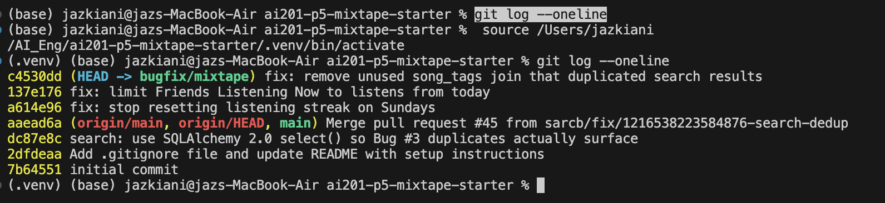

# Mixtape — Submission

## AI Usage

I used **Claude Code** (Anthropic's coding agent, running Claude Opus 5.5 in VS Code) throughout this project to run commands and tests, edit code, and made the fix commits on `bugfix/mixtape`. I directed the work one bug at a time and reviewed what it produced.

### How I used AI tools during codebase navigation and debugging

- **Getting a baseline.** Before any fix, it ran `pytest tests/` (9 passed, 4 failed) and matched each failing test to an issue: `test_streak_increments_on_sunday` for #1, `test_search_no_duplicates_multi_tag_song` for #3, and two playlist tests for #5. That told me which bugs already had a test and which (#2) didn't.
- **Reproducing each bug through the real endpoints.** I asked it to confirm each bug before changing code. It wrote a script that starts the app on an in-memory database, recreates the reporters' data (kenji, nova/darius, *Crown Heights Anthem* with 3 tags), and calls the HTTP endpoints. For the date-dependent bugs, it pinned the clock inside `streak_service` and `feed_service` with `unittest.mock`, so it could replay 15 straight days of listening or open the feed at 09:00, 22:59 and 23:01 the next day.
- **Tracing from route to service.** For each issue it followed the call chain from the endpoint in the report (for example `GET /users/<id>/streak` → `routes/users.py` → `streak_service.get_streak`) to see where the wrong value first appeared. For #1, that showed `get_streak` only reads a stored number, so the bug had to be on the write path (`POST /songs/<id>/listen` → `record_listening_event` → `update_listening_streak`).
- **Searching to narrow the scope.** It used `grep` to confirm that `update_listening_streak` is the only code that changes `listening_streak` and that `RECENT_THRESHOLD` was used nowhere else. That also told me which other code a fix could affect.
- **Looking inside the query (#3).** It printed the SQL generated by `search_songs()`, which showed a `LEFT OUTER JOIN song_tags` that nothing selects or filters on. It then counted the rows that same query returned in three different ways.
- **Checking for side effects after each fix.** It reran the test suite and the reproduction script, then wrote one-off checks for edge cases near each change: a skipped Saturday before a Sunday, a listen at exactly midnight, and every seeded song searched by title and by artist in upper and lower case.

### What they helped me understand

- **Issue #1:** Python's `datetime.weekday()` returns `6` for Sunday. So `and today.weekday() != 6` meant "never increment on a Sunday," which explained why kenji's streak reset only on Sundays and recovered on Monday.
- **Issue #2:** The difference between a *rolling 24-hour window* and a *calendar day*. The reproduction made this concrete: darius's 23:00 listen was still shown at 22:59 the next day and gone at 23:01, a flip at 24 hours to the minute.
- **Issue #3:** This was the most useful explanation. I learned why a join to a link table multiplies rows (one row per song–tag pair), and why the bug only appeared after commit `dc87e8c`: the old `db.session.query(Song)` API quietly removes duplicate objects, and the newer `select(...).scalars()` does not. Running the same query three ways gave 3 raw rows, 3 results with `scalars()`, and 1 with the legacy API. That convinced me the extra join was always there and the old API had been hiding it.
- **The codebase's structure:** Routes only check inputs and format responses, and the services do the actual work, so a wrong value in a response almost always traces back to a single service function. I also learned that the feeds are built from `ListeningEvent` rows each time they're requested, so a bug in the feed is in the query, not in stored data.
- **Testing technique:** How to test date-dependent behavior by replacing a module's `datetime` with a fixed clock, instead of waiting for a real Sunday.

### Where I verified or overrode their output

- **The Issue #2 contract was overstated.** The first draft said the code broke the feature's "today" contract. When the entry was checked against the code, the original docstring only says "recently." The "today" requirement comes from the issue report and the feature name, not from the code, and the final entry now says so.
- **The Issue #2 fix only works for users near UTC.** The AI chose UTC midnight as "today" so the feed matches `streak_service`. It called this a design choice while fixing #2, but it only pointed out the consequence later, while drafting this section. For a user in US Eastern time, darius's 11 pm Sunday listen is 04:00 UTC Monday, so it would still show in Monday's feed. Users have no timezone field, so a complete fix needs a schema change. The same limitation applies to streaks (#1).
- **The reproductions were not blind.** It read the service files before writing the reproduction script, so the reproduction notes for #2 and #3 already named the likely cause. The failing output is real and came before any code changed, but it confirmed a suspicion rather than starting from a blank slate.
- **The fixes went slightly past "one line."** For #2 and #3 it also removed a constant and imports that the fix left unused. The diffs show these were only dead code, but the fixes are not strictly the smallest possible change.
- **Some checks aren't in the repo.** The edge-case checks for #2 (midnight boundary, newest-per-friend, activity feed) and the full seed-data sweep for #3 ran as one-off scripts in a temporary folder. They aren't committed tests, so they can't be re-run from the repo, and there were no feed tests to begin with.

**What I checked myself:** I re-ran `pytest tests/` myself after the fixes to confirm the results matched what the AI reported. I also read the diff of each fix commit (`a614e96`, `137e176`, `c4530dd`) to make sure every change matched its root cause analysis entry and that nothing else in the file had been touched.

The three fix commits on `bugfix/mixtape`, on top of `main`:



## Codebase Map

Mixtape is a Flask + Flask-SQLAlchemy (SQLAlchemy 2.x) JSON API backed by SQLite. Friends share songs, rate them, build shared playlists, track daily listening streaks, and see what their friends are listening to. The code is in three layers: **routes → services → models**, with `app.py` holding them together.

```
HTTP request
   │
   ▼
routes/*.py        Flask Blueprints: parse JSON/query args, check required fields,
   │               call one service function, turn the result into JSON + status code
   ▼
services/*.py      Business logic: look up entities, apply rules, read/write via db.session,
   │               raise ValueError for "not found"/invalid input
   ▼
models.py          SQLAlchemy models + association tables, each model has to_dict()
   │
   ▼
SQLite (mixtape.db, or :memory: in tests)
```

---

### Top-level files

**`app.py`** is the application factory. It creates the module-level `db = SQLAlchemy()` object that every other module imports (`from app import db`). `create_app(config=None)`:
- sets `SQLALCHEMY_DATABASE_URI` (from the `DATABASE_URL` env var, defaulting to `sqlite:///mixtape.db`) and `SECRET_KEY`, then applies any override dict passed in (the tests use this to switch to an in-memory DB)
- binds `db` to the app
- imports and registers the four blueprints under URL prefixes: `/songs`, `/playlists`, `/users`, `/feed`
- runs `db.create_all()` inside an app context so the tables exist on startup

The blueprints are imported *inside* `create_app`. Because routes and services import `db` from `app`, this ordering lets `db` exist before anything that depends on it is loaded.

**`models.py`** defines 7 SQLAlchemy models and 3 association tables. All primary keys are UUID strings made by `generate_uuid()`, and all timestamps default to `datetime.now(timezone.utc)`.

| Model | Key columns | Relationships |
|---|---|---|
| `User` | `username`, `email` (both unique), `listening_streak`, `last_listened_at` | `shared_songs`, `ratings`, `listening_events`, `notifications`, `playlists`, and a self-referential `friends` (through `friendships`, `lazy="dynamic"`, so `user.friends` is a query object) |
| `Tag` | `name` (unique) | reached from `Song.tags` |
| `Song` | `title`, `artist`, `album`, `genre`, `shared_by` (FK → User), `shared_at`, `share_note` | `ratings`, `listening_events`, `tags` (through `song_tags`) |
| `ListeningEvent` | `user_id`, `song_id`, `listened_at` | backrefs `listener`, `song` |
| `Rating` | `user_id`, `song_id`, `score` (1–5), `rated_at` | `UniqueConstraint(user_id, song_id)`, so each user has one rating per song |
| `Playlist` | `name`, `created_by`, `created_at`, `is_collaborative` | `songs` (through `playlist_entries`) |
| `Notification` | `user_id` (recipient), `notification_type`, `body`, `created_at`, `read` | backref `recipient` |

Association tables:
- **`friendships(user_id, friend_id)`**: a directed edge per row. A mutual friendship is stored as two rows (A→B and B→A), which is how `seed_data.py` writes them. `User.friends` follows `user_id → friend_id`.
- **`song_tags(song_id, tag_id)`**: a plain many-to-many link between songs and tags.
- **`playlist_entries(playlist_id, song_id, position, added_by, added_at)`**: links playlists to songs and also stores metadata about each link. `position` gives songs an explicit order within a playlist, and `added_by` records which user contributed each song. This is what makes playlists collaborative at the data level.

Every model except `Tag` has a `to_dict()` method, and it is the only way the app serializes data. Services return either model instances or lists of these dicts. `Song.to_dict()` adds a `tags` list of tag names, and `User.to_dict()` leaves out `email`.

**`seed_data.py`** is a standalone script (`python seed_data.py`) that drops and recreates every table, then inserts 5 users with mutual friendships, 13 songs (3 with no tags, 5 with one tag, 5 with three tags; the script's docstring says 25, but the code inserts 13), 3 playlists, two weeks of listening events, existing streaks, ratings, and notifications. It writes association-table rows directly with `table.insert().values(...)`.

**`tests/`** has pytest suites for the streak, search, and playlist services. Each builds its own app with `create_app({"TESTING": True, "SQLALCHEMY_DATABASE_URI": "sqlite:///:memory:"})`, seeds just the rows it needs through fixtures, and calls service functions directly instead of going through HTTP.

---

### Routes layer (`routes/`)

Each file is one Flask `Blueprint`. Each handler pulls values from `request.get_json()` or `request.args`, returns a 400 if a required field is missing, calls one service function inside `try/except ValueError`, and maps the result to JSON.

| File | Prefix | Endpoints → service function |
|---|---|---|
| `routes/songs.py` | `/songs` | `GET /search?q=` → `search_service.search_songs` · `GET /<song_id>` → `search_service.get_song` · `POST /<song_id>/rate` → `notification_service.rate_song` · `POST /<song_id>/listen` → `streak_service.record_listening_event` |
| `routes/playlists.py` | `/playlists` | `POST /` → `playlist_service.create_playlist` · `GET /<playlist_id>` → `playlist_service.get_playlist` · `GET /<playlist_id>/songs` → `playlist_service.get_playlist_songs` · `POST /<playlist_id>/songs` → `notification_service.add_to_playlist` |
| `routes/users.py` | `/users` | `GET /<user_id>` → direct `db.session.get(User, ...)` · `GET /<user_id>/streak` → `streak_service.get_streak` · `GET /<user_id>/notifications?unread_only=` → `notification_service.get_notifications` · `POST /notifications/<notification_id>/read` → `notification_service.mark_as_read` |
| `routes/feed.py` | `/feed` | `GET /<user_id>/listening-now` → `feed_service.get_friends_listening_now` · `GET /<user_id>/activity` → `feed_service.get_activity_feed` |

List endpoints wrap their results in an envelope with a count (`{"results": [...], "count": n}`, `{"feed": ...}`, `{"songs": ...}`, `{"notifications": ...}`). Create endpoints return `201`.

---

### Services layer (`services/`)

**`streak_service.py`**: listening events and daily streaks.
- `record_listening_event(user_id, song_id)` creates a `ListeningEvent` timestamped now (UTC), calls `update_listening_streak`, commits once, and returns the event.
- `update_listening_streak(user, now)` compares `now.date()` with the date of `user.last_listened_at` (treated as UTC if naive). On a first listen it sets the streak to 1. On the same day it changes nothing. On the next day it adds 1. After a longer gap it sets the streak to 1. Then it updates `last_listened_at`. It changes the `User` in place and leaves the commit to the caller.
- `get_streak(user_id)` returns `user.listening_streak`.

**`feed_service.py`**: builds friend feeds on request from `ListeningEvent` rows. There is no separate feed table.
- `get_friends_listening_now(user_id)` gets the user's friend IDs, queries friends' events from the last 24 hours (`RECENT_THRESHOLD`) newest first, keeps only each friend's most recent event, and returns `{friend, song, listened_at}` dicts.
- `get_activity_feed(user_id, limit=20)` uses the same friend lookup without the time window or the one-per-friend step, and returns the newest `limit` events.

**`search_service.py`**: reading song data.
- `search_songs(query)` uses a 2.0-style `select(Song)` with an outer join to `song_tags`, does a case-insensitive `ilike` match on title or artist, and returns song dicts.
- `get_song(song_id)` returns one song dict.

**`playlist_service.py`**: playlist creation and reads.
- `create_playlist(name, created_by_user_id, is_collaborative=True)` checks that the creator exists, then inserts and returns the `Playlist`.
- `get_playlist_songs(playlist_id)` joins `Song` to `playlist_entries` for this playlist, orders by `position` ascending, and returns song dicts.
- `get_playlist(playlist_id)` returns the playlist's metadata dict.
- `get_user_playlists(user_id)` returns every playlist where `created_by == user_id`.

**`notification_service.py`**: notifications, plus the user actions that cause them (adding to a playlist, rating).
- `create_notification(user_id, notification_type, body)` is the shared helper. It inserts and commits one `Notification`. Its callers pass a type string such as `"song_added_to_playlist"`.
- `add_to_playlist(playlist_id, song_id, added_by_user_id)` loads the song, the adder, and the playlist, appends the song to `playlist.songs` if it isn't already there, then calls `create_notification` for the song's original sharer (`song.shared_by`) when that's a different user than the adder. It imports `Playlist` and `playlist_service` inside the function.
- `rate_song(user_id, song_id, score)` checks that the score is 1–5, loads the song and the rater, then updates the user's existing `Rating` for that song or creates a new one, commits, and returns it.
- `get_notifications(user_id, unread_only=False)` returns the user's notifications newest first, optionally only unread ones.
- `mark_as_read(notification_id)` sets `read = True`.

---

### Data flow 1: a user rates a song

```
POST /songs/<song_id>/rate   {"user_id": "...", "score": 4}
```
1. **`routes/songs.py` → `rate(song_id)`** reads the JSON body and returns `400` if `user_id` or `score` is missing. It converts `score` with `int(score)` and calls `rate_song(user_id, song_id, score)`.
2. **`services/notification_service.py` → `rate_song`**
   1. If `score` is outside 1–5, it raises `ValueError`.
   2. `db.session.get(Song, song_id)` raises `ValueError` if the song isn't found.
   3. `db.session.get(User, user_id)` raises `ValueError` if the user isn't found.
   4. `db.session.query(Rating).filter_by(user_id=..., song_id=...).first()` checks for an earlier rating.
   5. If one exists, its `score` is overwritten. If not, a new `Rating(user_id, song_id, score)` is added to the session. Either way the database's `unique_user_song_rating` constraint holds.
   6. `db.session.commit()`, then the `Rating` instance is returned.
3. **Back in the route**, the result is `jsonify(rating.to_dict())` with status `201`. Any `ValueError` becomes `{"error": ...}` with status `400`.

### Data flow 2: a song reaches a friend's "Listening Now" feed

The feed is computed when it's requested, so a song gets there in two steps: a write when someone listens, and a read when a friend opens their feed.

**Write: user F listens to a song**
```
POST /songs/<song_id>/listen   {"user_id": F}
 └─ routes/songs.py: listen()
     └─ streak_service.record_listening_event(F, song_id)
         ├─ db.session.get(User, F)
         ├─ ListeningEvent(user_id=F, song_id, listened_at=now) → session.add
         ├─ update_listening_streak(user, now)   (changes F's streak fields)
         └─ db.session.commit()                   (event + streak saved together)
```

**Read: user U opens the feed**
```
GET /feed/<U>/listening-now
 └─ routes/feed.py: listening_now()
     └─ feed_service.get_friends_listening_now(U)
         ├─ db.session.get(User, U)
         ├─ friend_ids = [f.id for f in user.friends]    (friendships rows where user_id = U)
         ├─ ListeningEvent where user_id IN friend_ids AND listened_at >= now − 24h, newest first
         ├─ keep the first (newest) event per friend
         ├─ for each: load User + Song, call to_dict()
         └─ list of {friend, song, listened_at}
 └─ jsonify({"feed": [...], "count": n})
```
F's song appears in U's feed when a `friendships` row (U → F) exists, F's listen is from the last 24 hours, and it is F's most recent listen.

### Data flow 3: a song is added to a playlist (with a notification)
```
POST /playlists/<playlist_id>/songs   {"song_id": S, "added_by": A}
 └─ routes/playlists.py: add_song()
     └─ notification_service.add_to_playlist(playlist_id, S, A)
         ├─ load Song S, User A, Playlist      (ValueError → 400 if any is missing)
         ├─ playlist.songs.append(song) + commit   (writes a playlist_entries row)
         └─ if song.shared_by != A:
               create_notification(song.shared_by, "song_added_to_playlist", "<A> added your song ...")
 └─ {"message": "Song added to playlist"}, 201
```
The original sharer then sees it at `GET /users/<sharer>/notifications`, and can mark it read with `POST /users/notifications/<id>/read`.

---

### Patterns in how the app is organized

- **Thin routes, logic in services.** Route handlers only check that required fields are present and format responses. Lookups, validation rules, and every database write happen in `services/`. The one exception is `GET /users/<user_id>`, which reads the `User` directly in the route because there is no logic to delegate.
- **`ValueError` is the error signal between layers.** Services raise `ValueError(f"... not found")` or a validation message. Routes catch it and pick the status code by endpoint: `404` for read and lookup endpoints, `400` for create and update endpoints.
- **Look up, then raise.** Almost every service function starts with `obj = db.session.get(Model, id)` and `if not obj: raise ValueError(...)` before doing anything else.
- **Serialization lives on the models.** `to_dict()` is the single conversion from model to JSON. Read services return lists of dicts, and write services return model instances that the route then calls `.to_dict()` on.
- **Services are grouped by feature, not by table.** For example, `rate_song` and `add_to_playlist` live in `notification_service.py` because they belong to the "friends interacting with your songs" feature, while plain playlist reads live in `playlist_service.py`. That's why two playlist endpoints call two different service modules.
- **Each service function commits its own work.** Most service functions call `db.session.commit()` themselves. Helpers that only change an object (`update_listening_streak`) leave the commit to their caller, so related changes are saved together.
- **One shared `db` object.** `db` is created once in `app.py` and imported everywhere. Blueprints are imported inside `create_app()`, and `notification_service.add_to_playlist` imports some names inside the function, which keeps the module imports from depending on each other in a cycle.
- **Feeds are computed, not stored.** The activity and "listening now" feeds are built on each request from `ListeningEvent` and `friendships`, so recording a listen is the only write a feed needs.
- **Association tables can carry data.** `playlist_entries` stores ordering and who added each song, beyond just linking playlists to songs. `friendships` is directional, and a mutual friendship is two rows.
- **Mixed query styles.** Most services use the legacy `db.session.query(...)` API, while `search_service` uses the SQLAlchemy 2.0 `select(...)` + `db.session.execute(...).scalars()` style.
- **Tests skip HTTP and call services directly** against an in-memory SQLite database, one test module per service.

---

## Root Cause Analysis

**Issue #1 — My listening streak keeps resetting**

**How you reproduced it**

I reproduced this before changing any code. I used a fresh in-memory app (`create_app({"TESTING": True, "SQLALCHEMY_DATABASE_URI": "sqlite:///:memory:"})`) with one user, `kenji`, and one song. I fixed the clock inside `streak_service` to a set time so each listen fell on a specific calendar day.
- **Sequence:** I called `POST /songs/<song_id>/listen {"user_id": kenji}` once a day at 10:00 UTC for 15 days in a row, Mon 2026-10-05 through Mon 2026-10-19. After each listen I called `GET /users/<kenji>/streak`.
- **Observed:**
  - The streak climbed 1→6 (Mon–Sat), then dropped to **1** on Sun 10-11.
  - It climbed 2→7 through Sat 10-17, then dropped to **1** again on Sun 10-18.
  - It went to 2 on Monday.

  This matches kenji's report: the reset only happens on Sundays, and counting resumes normally on Monday.
- **Triggering condition:** A listen on a Sunday (UTC) when the previous listen was on Saturday, the day before. No day was skipped, but the streak still resets.

**How you found the root cause**

1. **`routes/users.py` → `streak_service.get_streak`.** The symptom shows up on `GET /users/<id>/streak`. That route calls `get_streak`, which only does `return user.listening_streak`. The wrong number is already stored by the time it's read, so the bug had to be on the write path.
2. **`routes/songs.py: listen()` → `streak_service.record_listening_event`.** This is the only write. It creates the `ListeningEvent`, calls `update_listening_streak(user, now)`, and commits. I grepped the project for `listening_streak` and confirmed that `update_listening_streak` is the only code that changes it at runtime. `seed_data.py` only sets starting values.
3. **`streak_service.update_listening_streak`.** I checked the date math first: for the Sat→Sun listen, `days_since_last` was correctly `1`. Then I read the branch that should have incremented: `elif days_since_last == 1 and today.weekday() != 6:`.

**Moment of confidence:** Python's `weekday()` returns `6` for Sunday. So the condition is false *only* on Sundays, and the code falls through to `else: user.listening_streak = 1`. That one clause explains every detail of the report: it only happens on Sundays, the streak shows exactly 1, and Monday counts normally because `weekday()` is `0`. It also explains the existing failing test, `test_streak_increments_on_sunday` (`assert 1 == 2`).

**The root cause**

The function is `update_listening_streak()` in `services/streak_service.py`. The module's own docstring says *"A streak increments when a user listens on consecutive calendar days. It resets to 1 if a day is skipped."* Neither rule mentions the day of the week. But the increment branch was guarded by `days_since_last == 1 and today.weekday() != 6`.

On a Sunday, `today.weekday()` is `6`, so the guard is false even when the previous listen was yesterday. Execution falls through to the `else` branch, which was written for skipped days and sets `listening_streak = 1`. As a result, a user who listened every day lost their whole streak every Saturday→Sunday, and it started over from 1 on Monday.

**Your fix**

I removed the `and today.weekday() != 6` clause, so the branch is now `elif days_since_last == 1:` (commit `a614e96`, `fix: stop resetting listening streak on Sundays`).

This fixes the root cause because the guard now checks only what the documented rule says: whether the last listen was on the previous calendar day. A Saturday→Sunday listen therefore reaches the increment branch like any other consecutive day. The reset branch still catches real gaps (`days_since_last >= 2`), and the same-day branch (`== 0`) is unchanged.

**Your side-effect check**

- **Tests:** All 5 tests in `tests/test_streaks.py` pass, including `test_streak_increments_on_sunday` (it was failing before). The existing tests for first listen, consecutive days, same-day double listen, and skipped-day reset still pass. The full suite went from 4 failed / 9 passed to 3 failed / 10 passed, and the 3 still failing are the known #3 and #5 bugs.
- **Edge cases near the change**, checked directly against `update_listening_streak`:
  - Fri → (skip Sat) → Sun still **resets to 1**. This is the important one: the fix didn't make Sundays always increment.
  - A second listen on the same Sunday leaves the streak unchanged.
  - Sun → Mon increments to 2.
- **Reproduction again:** the 15-day HTTP sequence now counts 1→15 straight through both Sundays.
- **Other callers:** `update_listening_streak` has only one caller, `record_listening_event`. No other code relied on the Sunday behavior.

---

**Issue #2 — Friends Listening Now shows people from yesterday**

**How you reproduced it**

I reproduced this before changing any code, again on a fresh in-memory app.
- **Setup:** Users `nova` and `darius` with a mutual friendship (two `friendships` rows), and one song. I added a `ListeningEvent` for darius at **Sun 2026-10-18 23:00 UTC**, which is his last listen. I fixed the clock inside `feed_service` to set times on the next day.
- **Sequence:** I called `GET /feed/<nova>/listening-now` at three times on Mon 2026-10-19:
  - 09:00 → `count=1`, darius shown (**bug**: his listen was yesterday)
  - 22:59 → `count=1`, darius still shown
  - 23:01 → `count=0`, darius finally disappears
- **Triggering condition:** A friend whose most recent listen was on the *previous calendar day*, less than 24 hours before the feed was requested. That's nova's report exactly: darius's 11 pm listen still shows at 9 am, and *"stuff from yesterday evening keeps hanging around in the feed until the same time the next day."*

**How you found the root cause**

1. **`routes/feed.py: listening_now()`.** It only calls `get_friends_listening_now(user_id)` and wraps the result in `{"feed", "count"}`. It does no filtering of its own.
2. **`services/feed_service.py: get_friends_listening_now()`.** It does three things:
   1. gets `friend_ids` from `user.friends`
   2. queries `ListeningEvent` where `user_id IN friend_ids AND listened_at >= cutoff`, newest first
   3. keeps the first event per friend

   The first and third steps were working: darius *is* nova's friend, and the 23:00 event *is* his newest. So the problem had to be in which events pass the time filter.
3. **The `cutoff` line**, `cutoff = datetime.now(timezone.utc) - RECENT_THRESHOLD`, with `RECENT_THRESHOLD = timedelta(hours=24)` defined at the top of the module. A grep showed `RECENT_THRESHOLD` was used nowhere else.

**Moment of confidence:** The three reproduction times lined up exactly with a 24-hour rolling window. The 23:00 listen was visible at 22:59 the next day and gone at 23:01, a flip at 24 hours to the minute. A calendar-day filter would have hidden it at every one of those times. Nothing else in the function depends on the clock, so this line was the specific cause.

**The root cause**

The function is `get_friends_listening_now()` in `services/feed_service.py`. The feature is "Friends Listening Now," and its intended meaning (from the issue) is *friends who have listened today*. The function's docstring only says "recently," which is vague enough that the code never committed to "today." The query keeps events where `listened_at >= now − 24 hours`, a rolling window measured back from the moment of the request, not from the start of the day.

Any listen from yesterday that is less than 24 hours old therefore passes. Darius's Sunday 23:00 listen stayed in nova's feed all through Monday until 23:00. The feed was answering "who listened in the last 24 hours" when it should have answered "who listened today."

**Your fix**

I changed the cutoff to the start of the current UTC day (commit `137e176`, `fix: limit Friends Listening Now to listens from today`):
```python
cutoff = datetime.now(timezone.utc).replace(hour=0, minute=0, second=0, microsecond=0)
```
This fixes the root cause because the filter's lower bound is now midnight today, not "now minus 24h." Any event from a previous calendar day falls before midnight and is excluded, however recent it is. Any event from today is still included.

I also removed the now-unused `RECENT_THRESHOLD` constant and `timedelta` import, and changed the docstring from "recently" to "today (UTC)" so the contract is stated.

"Today" is measured in UTC. Users have no timezone field, and `streak_service` already uses the UTC calendar date to decide what a day is, so the feed and the streak now agree. Using each user's local midnight would need a new user field and is outside this bug's scope.

**Your side-effect check**

- **Boundary cases** around the new cutoff, checked through the HTTP endpoint with the clock fixed to Mon 2026-10-19 09:00 UTC:
  - A friend who listened at exactly **00:00:00 today** is included, because the cutoff is inclusive.
  - A friend who listened at **23:59:59 yesterday** is excluded.
- **The newest-per-friend step:** a friend with two listens today appears **once, with the newer song**.
- **Other paths in the function:** a user with no friends still gets `{"feed": [], "count": 0}`, and an unknown user still gets a `404`.
- **The related feed:** `GET /feed/<id>/activity` uses the same friend lookup but has no time filter. It still returns all 4 events, including yesterday's, so the change didn't affect it.
- **Reproduction again:** darius no longer appears at Mon 09:00, 22:59, or 23:01.
- **Tests:** the full suite is unchanged at 3 failed / 10 passed (the known #3 and #5 failures). There are no existing feed tests, so the checks above are the only coverage for this fix.

---

**Issue #3 — The same song keeps showing up twice in search**

**How you reproduced it**

I reproduced this before changing any code, on a fresh in-memory app.
- **Setup:** Three songs whose titles match "Anthem", each with a different number of tags:
  - *Crown Heights Anthem* by Borough Kings, 3 tags (`rap`, `hip-hop`, `boom bap`), the same as in `seed_data.py`
  - *Late Night Anthem*, 1 tag (`lo-fi`)
  - *Anthem Untagged*, 0 tags
- **Sequence:** `GET /songs/search?q=Anthem`.
- **Observed:** `count=5` instead of 3. *Crown Heights Anthem* appeared **3 times** with identical dicts. The 1-tag and 0-tag songs appeared once each.
- **Triggering condition:** A matching song with 2 or more tags. The number of copies equaled the song's tag count. That explains why simone saw only *some* songs repeat, and why Crown Heights Anthem (3 tags) showed up three times.

**How you found the root cause**

1. **`routes/songs.py: search()`.** It returns 400 if `q` is empty, and otherwise wraps `search_service.search_songs(query)` as `{"results", "count"}`. It doesn't touch the list, so the duplicates come from the service.
2. **`services/search_service.py: search_songs()`.** The query is `select(Song).outerjoin(song_tags, Song.id == song_tags.c.song_id).filter(title/artist ILIKE ...)`, returned with `.scalars().all()`. Copies matching the tag count pointed straight at the join to `song_tags`.
3. **The generated SQL**, printed from the statement:
   ```sql
   SELECT song.id, song.title, ... FROM song LEFT OUTER JOIN song_tags ON song.id = song_tags.song_id
   WHERE lower(song.title) LIKE lower(:title_1)
   ```
   Nothing from `song_tags` is selected or filtered on.
4. **`models.py`.** `Song.to_dict()` builds its `tags` list from `self.tags`, the `Song.tags` relationship (`secondary=song_tags, lazy="subquery"`), which loads separately. So the tags in the output never came from this join.
5. **Git history.** Commit `dc87e8c` had just changed this query from legacy `db.session.query(Song)` to `select(Song)` + `.scalars()`.

**Moment of confidence:** I ran the same join against a 3-tag song in three ways:
- raw rows: **3**
- `select(...).scalars().all()`: **3** `Song` objects
- the old `db.session.query(Song)...all()`: **1**

That proved two things. The join multiplies rows by tag count, and the old `Query` API had been quietly removing the duplicate `Song` objects, which hid the extra join until the switch to `select()`.

**The root cause**

The function is `search_songs()` in `services/search_service.py`. Its docstring promises it *"Returns all songs where the title or artist contains the query string,"* meaning one entry per matching song. But the query does `LEFT OUTER JOIN song_tags` even though it never selects or filters on that table. The join to the song–tag link table produces one row per (song, tag) pair, so a song with *N* tags becomes *N* rows.

The 2.0-style `select(Song)` + `.scalars().all()` turns every row into a list entry and does not de-duplicate ORM objects the way legacy `Query` did. So each extra row became a separate, identical search result. Songs with 0 or 1 tags produce one row (the outer join keeps untagged songs as a single row with nulls), which is why only multi-tag songs repeated.

**Your fix**

I removed the `.outerjoin(song_tags, Song.id == song_tags.c.song_id)` line. I also removed the imports this left unused (`song_tags`, and `Tag`, which was never used). Committed as `c4530dd`, `fix: remove unused song_tags join that duplicated search results`.

This fixes the root cause because the query now reads only from `song`, so each matching song is exactly one row no matter how many tags it has. Nothing is lost, because the tags in each result come from the `Song.tags` relationship, not from the join.

I chose this over adding `.distinct()` or `.unique()`. Those would keep a join that does nothing and remove the duplicates afterward. Removing the join means the duplicates are never produced.

**Your side-effect check**

- **Tests:** All 5 tests in `tests/test_search.py` pass, including `test_search_no_duplicates_multi_tag_song` (it was failing before). The tests for basic match, single-tag, no-tag, and no-match results still pass. The full suite went from 3 failed / 10 passed to **2 failed / 11 passed**, and both remaining failures are the Issue #5 playlist tests, which are out of scope.
- **Tags still included:** results still carry complete tag lists. *Crown Heights Anthem* still shows `['rap', 'hip-hop', 'boom bap']`, and the untagged song shows `[]`.
- **Real seed data:** I loaded `seed_data.py` into a throwaway SQLite file.
  - `q=Anthem` returns *Crown Heights Anthem* once, which is the exact case simone reported.
  - I searched for every one of the 13 seeded songs (3 with 0 tags, 5 with 1, 5 with 3) four ways: by title, by artist, in UPPERCASE, and in lowercase. Each came back exactly once with the correct tags.
  - So untagged songs are still found without the outer join, artist matching still works, and case-insensitive matching still works.
- **Input check:** `GET /songs/search` with no `q` still returns `400`.
- **Other code:** `search_songs` is only called from `routes/songs.py`, and `get_song` in the same file was not touched.
